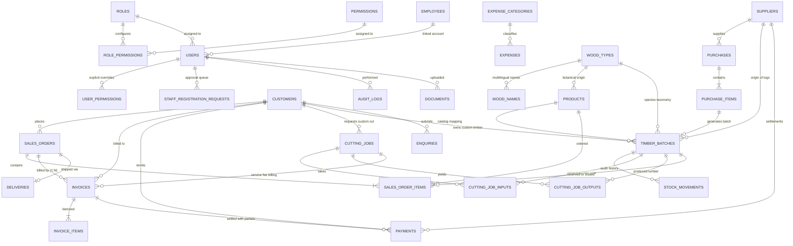

# Saw Mill Management System (TimberCraft) — Normalized MySQL Database Design

**Database Name:** `sawmill_db`  
**Storage Engine:** `InnoDB`  
**Character Set & Collation:** `utf8mb4` / `utf8mb4_unicode_ci`  
**Driver / Client:** `mysql2/promise` with Connection Pooling  

---

## 1. Executive Architecture & Design Principles

This database is designed specifically for timber sawmills, commercial lumber distribution, and custom sawing job shops operating in India. It handles both the public-facing e-commerce / quote inquiry layer and the internal ERP operations (timber batching, volumetric calculations, multi-admin / staff governance, cut tracking, invoice generation with Indian GST and vernacular languages, and audit trails).

### Key Architectural Tenets:
1. **Third Normal Form (3NF) Normalization:** Entities are partitioned logically with foreign key constraints, minimizing redundancy while preserving historical referential integrity.
2. **Strict Financial & Volumetric Precision (`DECIMAL`):**
   - Monetary values (costs, prices, taxes, payment totals) use `DECIMAL(12, 2)` or `DECIMAL(14, 2)`.
   - Timber volumes and dimensions use `DECIMAL(12, 3)` for cubic feet (CFT) and board feet, ensuring no floating-point rounding errors during log conversion.
3. **Immutable Inventory Movements Ledger:** Stock levels are maintained on `timber_batches`, but every single mutation (receipt, issue, cutting consumption, saw output, reservation, adjustment) is recorded as an immutable ledger entry in `stock_movements`.
4. **Segregation of Mill Stock vs. Customer Timber:** `timber_batches` explicitly segregates `ownership = 'mill'` from `ownership = 'customer'`, prohibiting accidental sale of lumber brought in by third-party clients for custom sawing.
5. **Partial Payments & Multi-Invoice Orders:** `invoices` supports milestone and partial delivery billing against `sales_orders`. The `payments` table tracks partial cash, bank transfer, and UPI receipts linked to invoices and purchases.
6. **Robust Role & Permission Governance:** `roles`, `permissions`, `role_permissions`, `users`, `staff_registration_requests`, and `user_permissions` provide granular access control with zero plain-text password exposure (bcrypt hashes only) and owner protection.

---

## 2. Entity Relationship Overview



---

## 3. Table Catalog & Detailed Specification

The 25 primary tables plus foundational supporting tables are organized below:

### 3.1 Authentication, Staff & Governance (Tables 1-4, 21)
1. **`roles`**: System roles (`owner`, `admin`, `manager`, `operator`, `accountant`, `staff`).
2. **`permissions`**: Granular capability keys (e.g., `view_inventory`, `manage_invoices`, `manage_staff`, `manage_admins`, `view_finance_reports`).
3. **`role_permissions`**: Many-to-many junction assigning permissions to roles.
4. **`users`**: Secure credential store with bcrypt `password_hash`, `token_version` for instant revocation, `status` (`active`, `pending`, `rejected`, `suspended`, `inactive`), and links to employee profiles.
5. **`staff_registration_requests`**: Approval queue for self-registered staff. Captures full name, contact email, requested department, and timestamps until an authorized admin approves and assigns specific permissions.
6. **`user_permissions`** & **`user_permission_settings`**: Per-user override tables allowing custom permissions to be granted to individual admins or staff members beyond base roles.
7. **`employees` (Table 21)**: Sawmill workforce registry storing official employee codes, departments, job titles, joining dates, encrypted salary details, and status.

### 3.2 Parties: Customers & Suppliers (Tables 5-6)
8. **`customers` (Table 5)**: Commercial clients, furniture workshops, construction contractors. Stores GST tax numbers, credit limits, payment terms, and status.
9. **`suppliers` (Table 6)**: Forest concessions, timber contractors, and round log sellers. Tracks vendor codes, regions, specialties, payment terms, and ratings.

### 3.3 Botanical Taxonomy & Product Catalog (Tables 7-8)
10. **`wood_types` (Table 7)**: Master botanical species list (e.g., Teak, Neem, Sandalwood, Rosewood, Deodar, Sal, Silver Oak) with scientific names, verification status, air-dry density, and durability classes.
11. **`wood_names`**: Multilingual translation table mapping wood species to Indian vernacular scripts (Kannada, Hindi, Telugu, Tamil, Malayalam, etc.) for localized invoicing and public website catalog display.
12. **`products` (Table 8)**: Standardized lumber offerings (e.g., dimensional lumber, planks, beams, live edge slabs) with standard measurements, default rates, and descriptions.

### 3.4 Inventory & Volumetric Tracking (Tables 9-10)
13. **`timber_batches` (Table 9)**: Physical inventory yard stock:
    - **Raw Logs:** Calculated using the **Hoppus Quarter-Girth Formula**:
      $$\text{Volume (CFT)} = \left(\frac{\text{Girth in inches}}{4}\right)^2 \times \frac{\text{Length in feet}}{144}$$
    - **Sawn Timber:** Calculated using **Rectangular Volumetric Formula**:
      $$\text{Volume (CFT)} = \frac{\text{Thickness (in)} \times \text{Width (in)} \times \text{Length (ft)} \times \text{Pieces}}{144}$$
    - **Segregation of Ownership:** `ownership` (`mill` vs. `customer`) and `customer_id`.
    - **Quantities Tracked:** `quantity_total`, `quantity_available`, `quantity_reserved` (for confirmed sales orders), and `quantity_consumed`.
14. **`stock_movements` (Table 10)**: Immutable double-entry audit ledger recording every inventory receipt, issue, adjustment, cutting consumption, reservation, or release with before/after quantity snapshots, authorizing user, and transaction references.

### 3.5 Purchases & Procurement (Tables 11-12)
15. **`purchases` (Table 11)**: Supplier purchase orders with unique reference numbers (`PUR-YYYY-XXXX`), subtotal, discounts, GST tax, freight charges, total costs, and payment status.
16. **`purchase_items` (Table 12)**: Line items detailing species, log girth, dimensions, pieces count, volumetric CFT, unit cost, and generated timber batch links upon goods receipt.

### 3.6 Sawmill Cutting Operations & Yields (Tables 13-15)
17. **`cutting_jobs` (Table 13)**: Production work orders for bandsaws and resaws. Tracks kerf allowance, input volume, output volume, waste volume, recovery yield percentage, cutting rate per CBF, and labour charges.
18. **`cutting_job_inputs` (Table 14)**: Log batches reserved and consumed on the carriage.
19. **`cutting_job_outputs` (Table 15)**: Finished dimensional planks, beams, and slabs generated, automatically posting new stock batches into inventory.

### 3.7 Sales, Orders & Fulfillment (Tables 16-17, 22)
20. **`sales_orders` (Table 16)**: Wholesale and custom orders with status workflows (`draft` → `confirmed` → `processing` → `completed` or `cancelled`).
21. **`sales_order_items` (Table 17)**: Itemized lumber products with pricing, line discounts, GST, and FIFO batch costing snapshots.
22. **`deliveries` (Table 22)**: Transportation logistics, vehicle registration, driver details, dispatched/delivered statuses, and proof-of-delivery notes.

### 3.8 Billing, Partial Payments & Expenses (Tables 18-20)
23. **`invoices` (Table 18)**: Authoritative financial invoice master supporting multiple invoices per sales order, multilingual output (Indian languages), tax breakdowns, and non-destructive voiding.
24. **`invoice_items`**: Itemized lines with wood type, dimensions, CFT quantity, rate, and tax.
25. **`payments` (Table 19)**: Master settlement ledger supporting partial customer payments against invoices and supplier disbursements. Enforces unique idempotency keys, records payment methods (Cash, UPI, NEFT/RTGS, Cheque), and handles reversals without deleting ledger history.
26. **`expenses` (Table 20)** & **`expense_categories`**: Operating expenses (mill electricity, diesel, saw blade sharpening, labour, maintenance) with reversal audit trails.

### 3.9 Inquiries, Documents & Audit (Tables 23-25)
27. **`enquiries` (Table 23)**: Public website quote inquiries and requests for custom timber cutting, with status tracking (`new`, `qualified`, `in_progress`, `converted`, `closed`).
28. **`documents` (Table 24)**: Centralized document metadata for generated invoice PDFs, delivery challans, forest transit passes, and sawmill compliance certificates.
29. **`audit_logs` (Table 25)**: Tamper-evident administrative audit records logging user IDs, action names, target tables, record IDs, IP addresses, and JSON payloads of changes.

---

## 4. How to Apply the Schema to Local MySQL

### Step 1: Ensure MySQL is Running
- **Windows (Service):**
  ```powershell
  net start MySQL
  ```
- **XAMPP / WAMP:** Ensure the MySQL module is running on port 3306.

### Step 2: Apply the Schema (`database/schema.sql`)
Run the schema script using the official MySQL command-line client:
```bash
mysql -u root -p < "c:/Users/PRAVEEN/OneDrive/Desktop/Saw Mill/database/schema.sql"
```
*(Or specify host and port if custom):*
```bash
mysql -h 127.0.0.1 -P 3306 -u root -p < "c:/Users/PRAVEEN/OneDrive/Desktop/Saw Mill/database/schema.sql"
```

### Step 3: Seed Foundational Data (`database/seed.sql`)
To load standard roles, granular permissions, botanical wood species, multilingual names, expense categories, and optional development test fixtures:
```bash
mysql -u root -p < "c:/Users/PRAVEEN/OneDrive/Desktop/Saw Mill/database/seed.sql"
```

### Step 4: Verify Database Installation
```sql
USE sawmill_db;
SHOW TABLES;
SELECT COUNT(*) AS total_tables FROM information_schema.tables WHERE table_schema = 'sawmill_db';
```
You should see all 41 tables (25 required primary tables plus supporting relation tables) successfully initialized.

